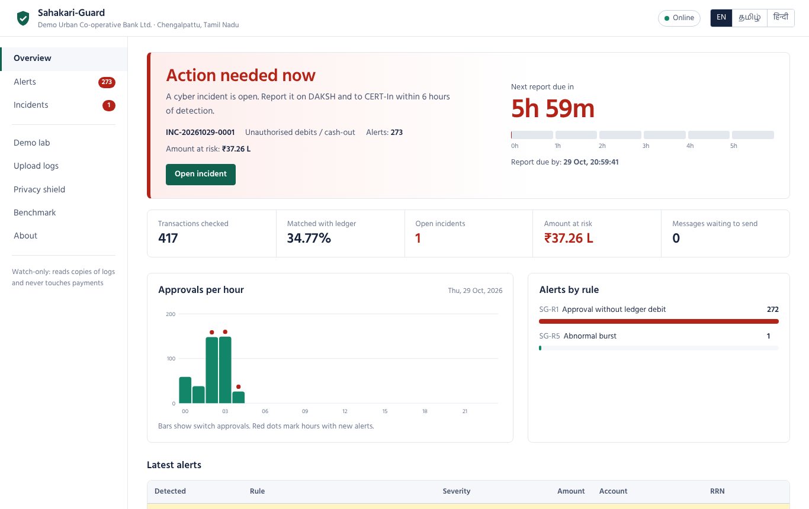
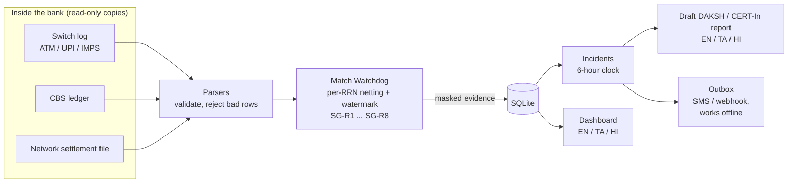
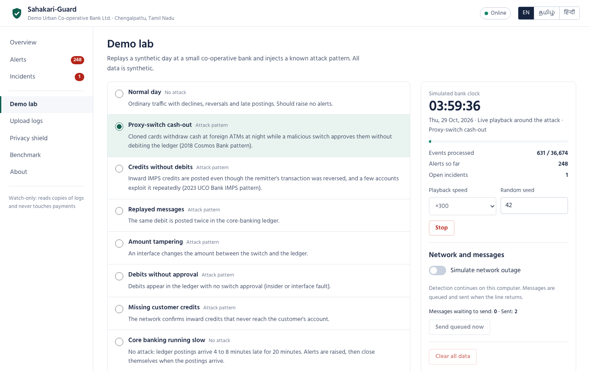
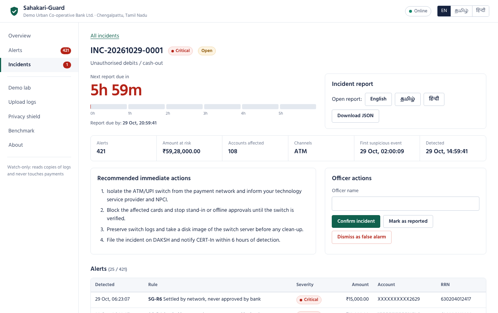
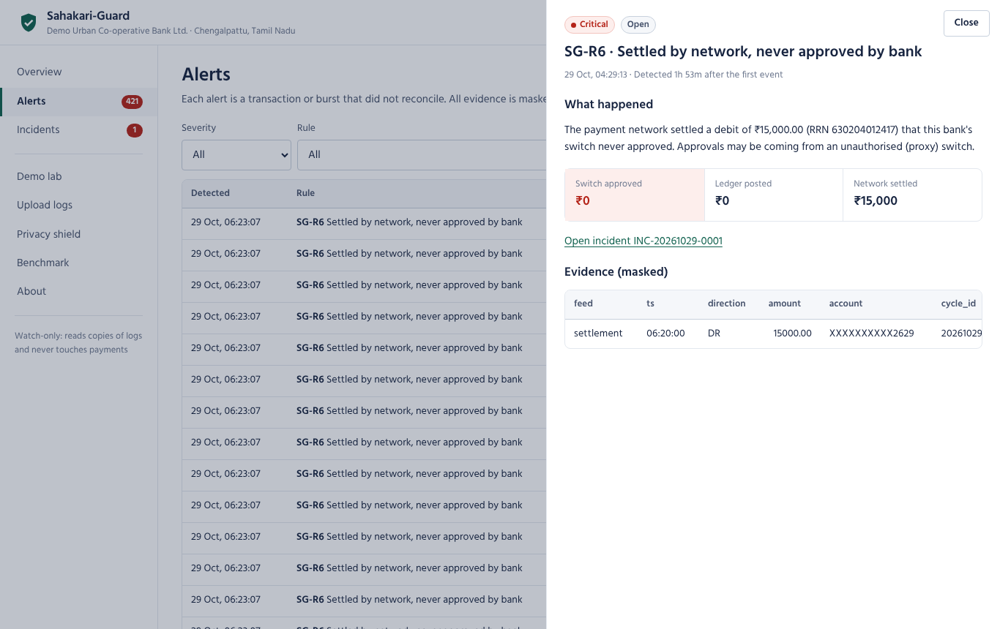
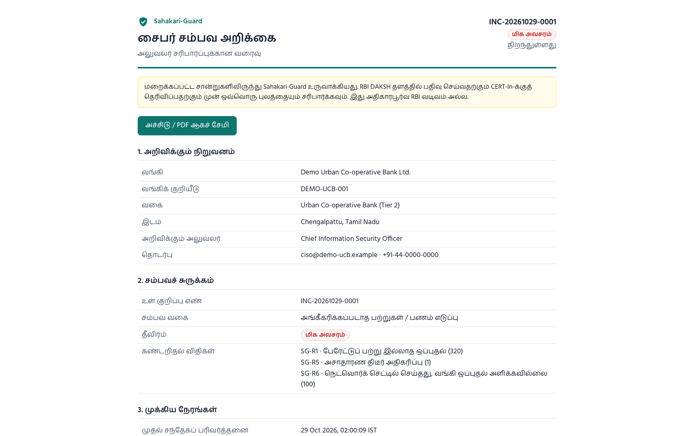
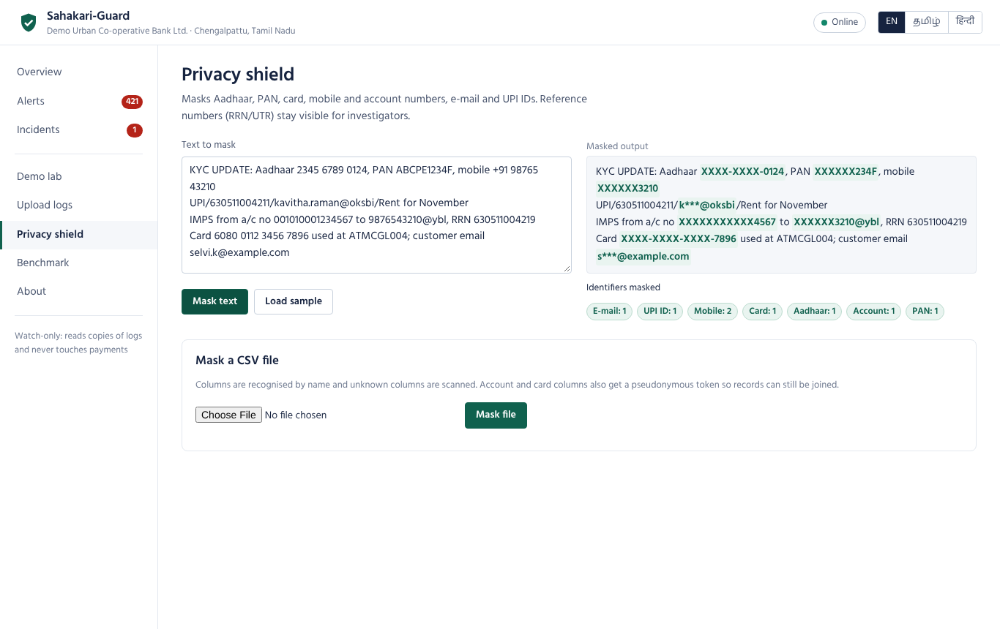
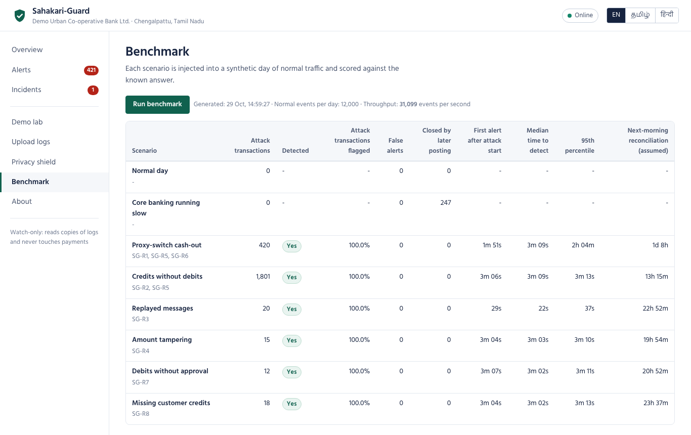
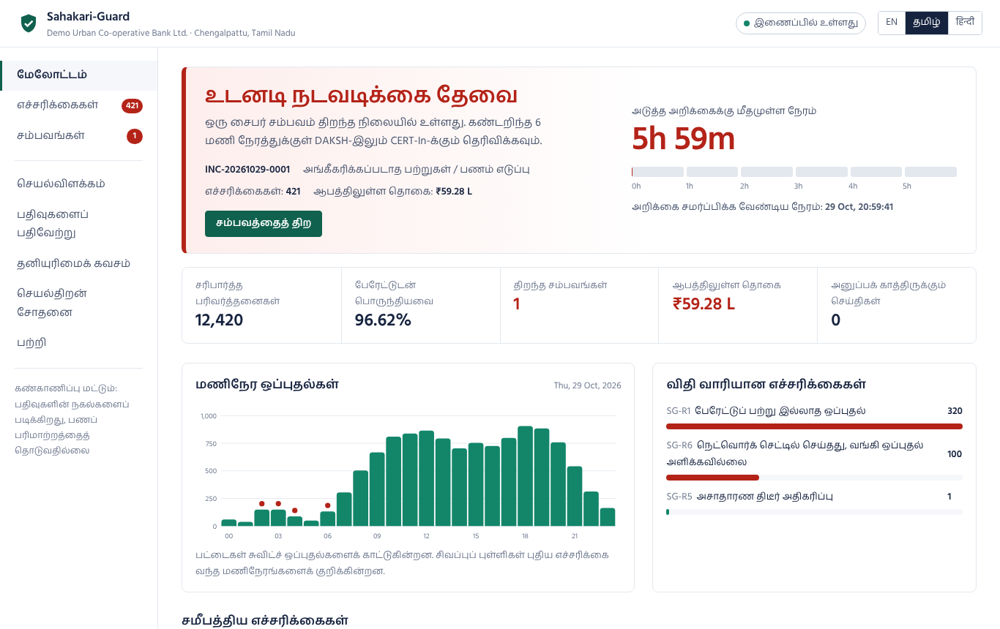
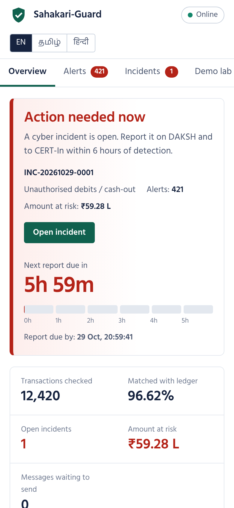

# Sahakari-Guard

**A low-cost, watch-only fraud watchdog, privacy shield and 6-hour cyber-incident reporting kit for India's co-operative banks.**

Seva First Innovation Challenge 2026 · Theme: *Surakshit Bharat* (security & resilience, digital public infrastructure) · Track A: Product or Technology



Sahakari-Guard reads *copies* of three logs a bank already produces: the payment switch log, the core-banking (CBS) ledger and the network settlement file. It checks, transaction by transaction, that all three agree. When money moves without the books agreeing, it raises an alert within minutes instead of at the next day's reconciliation, masks every personal identifier before storing anything, and turns a confirmed problem into a pre-filled draft report for the six-hour deadline, in English, Tamil or Hindi.

It never sits in the payment path, so it cannot slow down or break a payment.

---

## Why this matters

| What happened | What it shows |
|---|---|
| **2018, Cosmos Co-operative Bank (Pune):** attackers compromised the ATM switch and approved cloned-card withdrawals through a proxy switch; about **₹94 crore** was taken in two days. The bank said its core banking was not affected. [1] | Approvals can leave the bank without ever reaching the ledger. |
| **2023, UCO Bank IMPS incident:** about **₹820 crore** was credited to 41,000+ accounts over 8.5 lakh IMPS transactions between 10 and 13 November without matching debits at the originating banks. [2] | Credits can be posted without being funded, and it ran for days. |
| **2024, C-Edge Technologies ransomware:** payment systems at nearly **300 small banks**, mostly co-operative and regional rural banks, were shut down. [3] | Small banks share vendors and have little in-house security. |
| **31 July 2026, RBI Directions for urban co-operative banks:** cyber incidents must be reported on the **DAKSH** platform **within six hours of detection**. [4] | Detection that happens the next morning cannot meet a six-hour rule. |
| **DPDP Rules 2025:** full compliance due **13 May 2027**; failure of reasonable security safeguards can attract penalties up to **₹250 crore**. [5] | Raw Aadhaar, PAN and account numbers must not leak from logs. |

India has **1,330 functional urban co-operative banks and 340 district central co-operative banks** [6]. In 2026 the umbrella organisation NUCFDC launched a shared Security Operations Centre for urban co-operative banks [7]. Sahakari-Guard is designed to **complement** that effort as the bank-side sensor: it checks money movement at the source and masks personal data *before* logs leave the bank.

## What it does

1. **Match Watchdog** - streaming three-way reconciliation per reference number (RRN). Every switch approval must meet its ledger posting within 180 seconds; every credit must be funded; every network-settled debit must have been approved by the bank's own switch. Eight rules (below) cover proxy-switch approvals, unfunded credits, replays, amount tampering, cash-out bursts and missing customer credits.
2. **Privacy Shield** - masks Aadhaar (Verhoeff check), card numbers (Luhn check), PAN, mobile, account numbers, e-mail and UPI IDs, while keeping RRN/UTR visible for investigators. Account and card columns get a keyed pseudonymous token so masked records can still be joined.
3. **6-Hour Report Kit** - related alerts become one incident with a visible six-hour clock, recommended immediate actions, an officer workflow (confirm, dismiss, mark reported with the DAKSH acknowledgement number), and a printable draft report with SHA-256 hashes of the evidence.

Plus: a store-and-forward outbox (alerts are queued while the internet is down and sent when it returns), a dashboard in **English, Tamil and Hindi**, a demo lab that replays realistic attack days, and a benchmark.

## How it works



For every RRN the engine nets what the switch says moved (approvals minus accepted reversals) against what the ledger says moved (debits minus credits) and what the network settled. Netting makes it robust to reversals, timeouts and partial dispenses. If nothing new happens for an RRN for 180 seconds of log time, it is evaluated. A late posting re-opens the RRN and closes the alert by itself if the books then balance. Details: [docs/ARCHITECTURE.md](docs/ARCHITECTURE.md).

## Detection rules

| Rule | Detects | Real-world pattern | Severity |
|---|---|---|---|
| SG-R1 | Switch approved a debit, no matching ledger debit | Proxy / malicious switch (Cosmos 2018) | Critical |
| SG-R2 | Credit posted although the network leg failed or was reversed | Credits without debits (UCO 2023) | Critical |
| SG-R3 | Same RRN approved or posted twice | Replayed or duplicated messages | High |
| SG-R4 | Switch and ledger amounts differ | Interface tampering or bug | High |
| SG-R5 | Burst of approvals for one account, or foreign cash-out across many countries | Card-cloning cash-out, scripted exploitation | High |
| SG-R6 | Network settled a debit the bank's switch never approved | Approvals answered outside the bank's switch log | Critical |
| SG-R7 | Ledger debit with no switch approval | Insider posting or interface fault | Medium |
| SG-R8 | Network confirmed a credit, customer never credited | Customer harm (turnaround-time breach) - operational, not a cyber incident | Medium |

Full logic, thresholds and false-positive handling: [docs/DETECTION_RULES.md](docs/DETECTION_RULES.md).

## Results on synthetic data

Each scenario is injected into a synthetic day of 12,000 normal transactions at a small bank (with declines, reversals, late postings, failed inward credits and busy merchant accounts) and scored against the known answer. Reproduce with `python -m sahakari_guard bench`.

| Scenario | Attack transactions | Flagged | False alerts | First alert | Median time to detect | Next-morning reconciliation (assumed) |
|---|---:|---:|---:|---:|---:|---:|
| Normal day | 0 | - | 0 | - | - | - |
| Core banking slow (no attack) | 0 | - | 0 (247 raised and auto-closed) | - | - | - |
| Proxy-switch cash-out | 420 | 100% | 0 | 1m 51s | 3m 09s | 1d 8h |
| Credits without debits | 1,801 | 100% | 0 | 3m 06s | 3m 09s | 13h 15m |
| Replayed messages | 20 | 100% | 0 | 29s | 22s | 22h 52m |
| Amount tampering | 15 | 100% | 0 | 3m 04s | 3m 03s | 19h 54m |
| Debits without approval | 12 | 100% | 0 | 3m 07s | 3m 02s | 20h 52m |
| Missing customer credits | 18 | 100% | 0 | 3m 04s | 3m 02s | 23h 37m |

Engine throughput is about **30,000 log lines per second on one CPU core**; a small co-operative bank produces tens of thousands per day. Full table with 95th percentiles: [docs/BENCHMARK.md](docs/BENCHMARK.md).

> **Read these numbers honestly.** The synthetic data was generated with the same assumptions the engine makes, so zero false alerts here is a *floor*, not a promise. Real logs will contain formats and timing quirks we have not seen; measuring false alerts on masked real logs is the first goal of the pilot.

## Quick start

Needs **Python 3.10 or newer**. No internet connection is required after installation.

**Windows** - double-click `scripts\run.bat` (or run it from a terminal).

**macOS / Linux**

```bash
./scripts/run.sh
```

**Manual**

```bash
python -m venv .venv
.venv/bin/pip install -r requirements.txt          # Windows: .venv\Scripts\pip install -r requirements.txt
.venv/bin/python -m sahakari_guard serve           # Windows: .venv\Scripts\python -m sahakari_guard serve
```

Then open **http://127.0.0.1:8000**, go to **Demo lab**, choose **Proxy-switch cash-out** and press **Play scenario**. Watch the overview turn red, open the incident, and open the report in Tamil or Hindi.

**Docker**

```bash
docker build -t sahakari-guard .
docker run -p 8000:8000 -e SG_API_KEY=change-me -v sg-data:/data sahakari-guard
```

A step-by-step demo for judges and the video is in [docs/DEMO_SCRIPT.md](docs/DEMO_SCRIPT.md).

## Using it with log files

```bash
# Check one period of logs (exit code 1 if alerts are open, handy for scheduled jobs)
python -m sahakari_guard scan --switch switch_log.csv --ledger cbs_ledger.csv --settlement settlement.csv --fail-on-alert

# Near-real-time: watch a folder that a bank job keeps appending to, and show results in the dashboard
python -m sahakari_guard serve --watch-inbox ./inbox --clock wall

# Mask a file before sharing it with a vendor, auditor or shared SOC
python -m sahakari_guard mask customer_export.csv --out customer_export_masked.csv

# Export the draft report for an incident
python -m sahakari_guard report INC-20261101-0001 --lang ta --out report.html

# Write synthetic logs to try the CSV formats
python -m sahakari_guard simulate --scenario cosmos --out sample_data/cosmos
```

The three canonical CSV formats are documented in [docs/DATA_FORMATS.md](docs/DATA_FORMATS.md) and the JSON API in [docs/API.md](docs/API.md). Ready-made synthetic files are in [`sample_data/`](sample_data). The **Upload logs** page does the same as `scan` from the browser.

Configuration (bank name, thresholds, language, webhook) lives in [`sahakari_guard.example.toml`](sahakari_guard.example.toml) and environment variables (`SG_DATA_DIR`, `SG_API_KEY`, `SG_WEBHOOK_URL`, `SG_LANGUAGE`, `SG_TOKEN_SECRET`).

## Screenshots

| | |
|---|---|
|  Demo lab replaying a cash-out |  Incident with the six-hour clock |
|  Alert: switch, ledger and network side by side |  Draft report in Tamil |
|  Privacy Shield |  Benchmark |
|  Dashboard in Tamil |  Works on a phone |

## Code map

```
sahakari_guard/
  engine/       reconciler.py (per-RRN state, watermark, rules R1-R4, R6-R8), velocity.py (R5), rules.py, runner.py
  privacy/      masker.py (detectors + column policies), checksums.py (Verhoeff, Luhn), tokenizer.py (HMAC tokens)
  ingest/       parsers.py (canonical CSV feeds, row-level errors), tailer.py (incremental watch mode)
  incidents/    manager.py (grouping, lifecycle, 6-hour deadline)
  reports/      builder.py + templates/report.html (JSON + printable HTML, SHA-256 integrity)
  notify/       outbox.py (store-and-forward messages, retry with backoff)
  store/        repository.py (SQLite, WAL, one lock, transactions)
  simulator/    generator.py (synthetic small-bank day), scenarios.py (attack and noise patterns)
  i18n/         en.json, ta.json, hi.json (one catalogue for server and dashboard)
  api/          app.py (FastAPI, security headers, optional API key)
  web/          index.html, app.css, app.js (no build step, works offline, bundled Hind fonts)
  service.py    the single place where engine, storage, incidents and notifications meet
  demo.py       live demo playback and background benchmark
  watcher.py    folder watcher for pilots
  bench.py      benchmark and scoring
  cli.py        command line
tests/          95 tests: engine rules, privacy, parsers, incidents, reports, API, CLI, benchmark
```

## Privacy and security by design

* **Watch-only.** Reads log copies; no write access to the switch, CBS or network is needed.
* **Mask before store.** Evidence stored in the database, shown in the dashboard or written to reports contains only masked identifiers and keyed tokens. Tests check that raw account and card numbers never appear in reports.
* **Local first.** Runs on a computer inside the bank with SQLite; the dashboard binds to `127.0.0.1` by default. Set `SG_API_KEY` before exposing it on the bank LAN.
* **Tamper evidence.** Every uploaded file's SHA-256 is recorded, and each report carries a SHA-256 of its own content.
* **Defensive web defaults.** Strict Content-Security-Policy, no external scripts or fonts, all dynamic text escaped, `X-Frame-Options: DENY`, no caching of API responses.

See [SECURITY.md](SECURITY.md).

## Testing

```bash
pip install -r requirements-dev.txt
python -m pytest
```

GitHub Actions runs the tests on Ubuntu and Windows with Python 3.10 and 3.12, and re-runs the benchmark to make sure every scenario is still detected.

## Limitations

* Tested on **synthetic data only**. A shadow-mode pilot on masked real logs is the next step.
* Each bank or technology service provider needs a small **adapter** to convert its switch and CBS exports to the canonical CSV format.
* Engine state lives in memory; in watch mode, transactions pending at the moment of a restart are not re-evaluated (completed alerts and incidents are persisted).
* Reports are **drafts for a human officer** and are not an official RBI format. Sahakari-Guard is not affiliated with RBI, NPCI, NABARD or NUCFDC.
* Tamil and Hindi text should be reviewed by native speakers before a pilot.

## Roadmap

See [docs/PILOT_PLAN.md](docs/PILOT_PLAN.md): synthetic validation (done) → shadow-mode pilot with one co-operative bank near Chengalpattu / Chennai → 3-5 banks in two districts with an independent security audit → distribution through shared-service platforms and technology service providers, where one integration reaches many banks.

## Team

* *Your name* - role
* *Team member* - role
* Mentor: *name, department, institution*

## Licence and credits

MIT licence (see [LICENSE](LICENSE)). Fonts: Hind and Hind Madurai by Indian Type Foundry, SIL Open Font License 1.1. All bank data in this repository is synthetic; identifiers are randomly generated with valid check digits and belong to no one.

## References

1. Cosmos Bank cyber attack: [Finextra](https://finextra.com/newsarticle/32520/indias-cosmos-bank-falls-victim-to-global-atm-cash-out-fraud), [Deccan Herald](https://www.deccanherald.com/india/cosmos-bank-loses-rs-9442-cr-687542.html)
2. UCO Bank IMPS credits: [Free Press Journal](https://www.freepressjournal.in/amp/analysis/analysis-uco-banks-mysterious-credits-technical-glitch-or-brazen-fraud), [The Week / PTI](https://www.theweek.in/wire-updates/business/2024/03/07/del99-cbi-ld-imps.html)
3. C-Edge ransomware: [BusinessWorld](https://businessworld.in/article/ransomware-attack-hits-payment-systems-of-nearly-300-indian-banks-527929)
4. RBI (Urban Co-operative Banks - Cybersecurity, Technology: Risk, Resilience and Assurance Framework) Directions, 2026: [TaxGuru summary](https://taxguru.in/rbi/rbi-issues-cybersecurity-technology-risk-framework-directions-2026-urban-op-banks.html)
5. DPDP Rules 2025 timeline and penalties: [Treelife](https://treelife.in/?p=14990)
6. Number of UCBs and DCCBs (National Cooperative Database, March 2026): [Indian Cooperative](https://www.indiancooperative.com/co-op-news-snippets/1330-ucbs-in-india-maharashtra-karnataka-lead/)
7. NUCFDC Security Operations Centre and shared services: [Indian Cooperative](https://www.indiancooperative.com/?p=100663)
