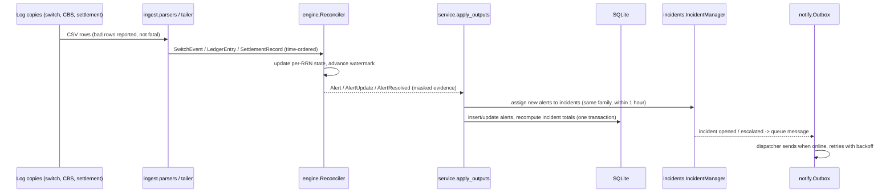
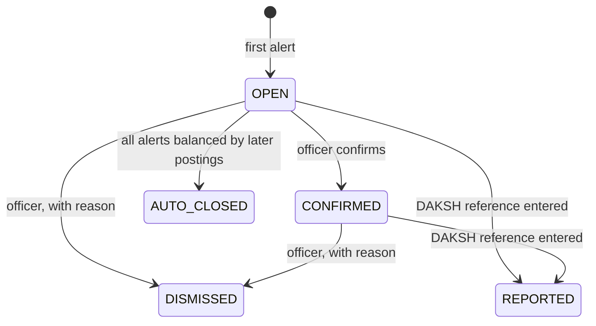

# Architecture

## Design goals

| Goal | Consequence in the design |
|---|---|
| Never put a payment at risk | Watch-only: reads copies of logs, never sits in the payment path, needs no write access |
| Run where small banks are | Pure Python + SQLite, one process, no internet needed, works on a branch PC or a VM |
| Detect within minutes, not at day-end | Streaming engine driven by event time with a heartbeat |
| No raw personal data at rest | Mask and tokenise inside the engine, before anything is stored or shown |
| Usable by a branch manager | Plain-language alerts in English, Tamil and Hindi; one status band with a six-hour clock |
| Testable and explainable | Engine is pure (no I/O, no clock reads); every rule has a stable ID and tests |

## Layers

```
api / cli / demo / watcher        entry points: HTTP, terminal, background threads
            │
         service.py                orchestration: runs, persistence, incidents, notifications
            │
engine · incidents · reports · notify · privacy · ingest · i18n
            │
models · money · timeutil · config  pure data types and helpers
```

Dependencies only point downwards. `service.GuardService` is the only class that touches both the engine and the database, so the API, CLI, demo runner and folder watcher behave identically.

## Data flow



## The Match Watchdog algorithm

For every reference number (RRN) the engine keeps a small state:

```
switch_net  = Σ approved AUTH amounts − Σ accepted REVERSAL amounts      (≥ 0)
ledger_net  = Σ debits − Σ credits         (sign flipped for inward credits)
settled     = Σ network-settled amounts by direction
deadline    = max(last event time, watermark) + match_window (180 s)
```

* **Watermark.** The highest event time seen. Each new event, or a heartbeat when logs are quiet, moves it forward. RRNs whose deadline has passed are popped from a min-heap and evaluated. Stale heap entries are skipped using a per-state version number (lazy deletion), so each event costs `O(log n)`.
* **Netting, not pairing.** Comparing net amounts makes reversals, timeouts before posting, posted-then-reversed and partial dispenses all balance naturally, without special cases.
* **Decision table** (evaluated at the deadline):

| Direction | Condition | Rule |
|---|---|---|
| Debit | network settled > 0 and switch never approved | SG-R6 |
| Debit | switch_net > 0, ledger_net ≤ 0 | SG-R1 |
| Debit | switch_net = 0, ledger_net > 0 | SG-R7 |
| Debit | both > 0, unequal | SG-R4 |
| Credit | ledger_net > 0, switch_net = 0 | SG-R2 |
| Credit | ledger_net > switch_net > 0 | SG-R4 |
| Credit | ledger_net ≤ 0, switch_net > 0 | SG-R8 |
| Either | second non-reversal posting or approval for the same RRN (raised immediately) | SG-R3 |

* **Self-correction.** A posting that arrives after the deadline re-opens the RRN. If it balances the books, the engine emits `AlertResolved` and the alert closes itself ("resolved by a later posting"). If all alerts of an un-confirmed incident close this way, the incident becomes `AUTO_CLOSED`. The `slowcbs` benchmark scenario exercises this path.
* **Idempotency.** Byte-identical lines (same journal ID, same switch message, same settlement cycle) are counted as `duplicate_lines_ignored` and do not raise SG-R3, so re-exporting a log file is harmless.
* **Retention.** Evaluated RRNs are kept for 48 hours of log time so late postings can still close alerts, then purged, keeping memory bounded.
* **Velocity (SG-R5)** uses sliding-window deques per account and a bank-wide window for foreign terminals. A burst is one *episode*: the first trigger creates an alert and later triggers update it until the burst is quiet for 30 minutes.

## Time

* **Event time** comes from the logs and drives detection. Naive timestamps are treated as IST (+05:30, fixed offset, so no time-zone database is needed on Windows).
* **Wall-clock time** is used only for the incident's `opened_at` and the six-hour reporting deadline, because RBI and CERT-In count from detection.
* In batch runs and the benchmark a 15-second **heartbeat** advances the watermark through quiet periods, matching live behaviour. In watch mode `--clock wall` does the same from the computer's clock.

## Storage

SQLite in WAL mode, one connection guarded by a re-entrant lock, explicit `BEGIN IMMEDIATE` transactions. Tables:

| Table | Purpose |
|---|---|
| `runs`, `source_files` | each scan/demo/watch run and the SHA-256 of every uploaded file |
| `alerts` | one row per alert: rule, severity, family, RRN, account token and masked account, amounts, params (JSON), masked evidence (JSON), status |
| `incidents` | grouped alerts, status, severity, deadline, totals, officer, DAKSH/CERT-In references |
| `incident_events` | append-only timeline (opened, escalated, confirmed, reported, notified ...) |
| `outbox` | queued messages with attempts, next attempt time, last error |
| `kv` | small settings and counters (network switch, statistics, benchmark result, ID sequences) |

Incident totals are always **recomputed from the alerts** after each batch, so they cannot drift. Burst alerts (SG-R5) describe the same money as the per-transaction alerts and are excluded from the amount at risk unless they are the only evidence.

## Concurrency

* One **run lock** guarantees only one batch (upload, instant scenario, demo playback) writes at a time; a second request gets HTTP 409 with a clear message.
* The **demo runner** and **folder watcher** own their engine instance in their own thread and publish statistics snapshots; API threads only read published snapshots and the database, never live engine state.
* The **outbox dispatcher** is a daemon thread that wakes every few seconds.

## Incident lifecycle



Invalid transitions return HTTP 409. Every transition is written to `incident_events` with the officer's name.

## Reports

`reports.builder.build_report` produces a JSON document (`sahakari-guard/incident-report/v1`) with entity, incident, timing, impact, rules, description, recommended actions, masked detections, evidence hashes and a filing checklist. The SHA-256 of the canonical JSON is embedded, so any later change is detectable. `render_report_html` renders the same data with an escaped Jinja2 template, printable to PDF from any browser.

## Web dashboard

A single static page (`web/index.html`, `app.css`, `app.js`): no build step, no CDN, bundled Hind / Hind Madurai fonts covering Latin, Devanagari and Tamil. All dynamic values pass through an escaping tagged template. The server sends a strict Content-Security-Policy (`script-src 'self'`). The six-hour clock ticks client-side, corrected for clock skew from the server time in each summary.

## Performance

About 30,000 log lines per second on one core (see [BENCHMARK.md](BENCHMARK.md)). A small co-operative bank produces tens of thousands of lines a day, so a single ordinary PC has headroom of several orders of magnitude, and a technology service provider could run one instance per few hundred banks.
